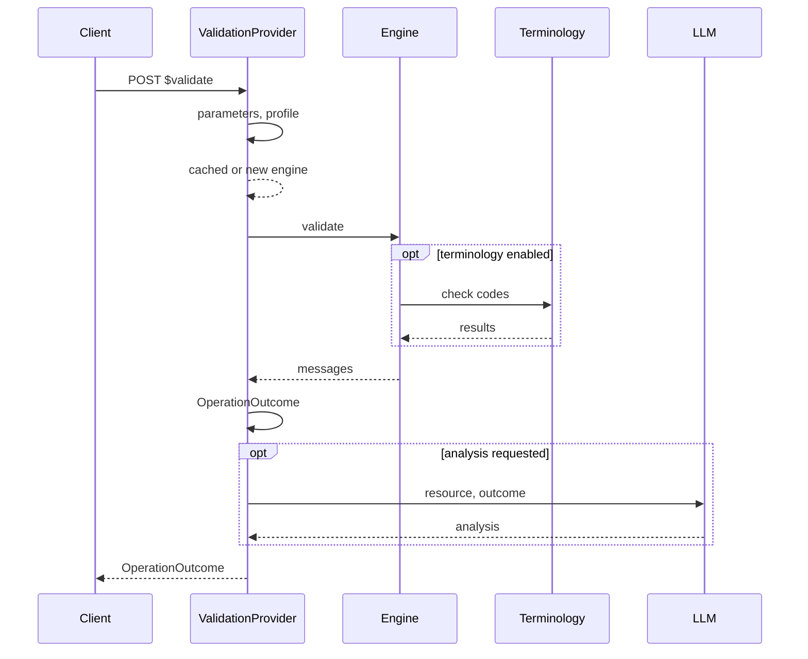

# Architecture

Matchbox consists of a library, a server built on it, and a web interface. This page explains what each part does, on
which projects they are built, and why they are separated.

## The three modules

```
matchbox
├── matchbox-engine     Java library: validation and transformation
├── matchbox-server     FHIR server: REST API around the engine, package storage, terminology server
└── matchbox-frontend   Angular web interface, served by matchbox-server
```

**matchbox-engine** contains the validation and transformation logic. It was extracted from the server so that the same
features can be embedded in another Java application, and work without a connection to the internet: the packages it
needs are loaded from the classpath or from files. Because the server uses the same engine, a map or a profile that was
developed and tested against matchbox-server gives the same result when it runs in an application that embeds
matchbox-engine.

**matchbox-server** makes the engine available as a microservice. It adds what a shared service needs: a FHIR API
(`$validate`, `$transform`, …), a database in which the implementation guides are installed, the management of several
engines (see [Validation engines](validation-engines.md)), an internal terminology server, the Gazelle validation API,
the MCP server and the analysis of validation results with an LLM.

**matchbox-frontend** is the web interface for validating, transforming and browsing the installed implementation
guides. It only uses the FHIR API of the server.

## What Matchbox is built on

| Project | Used for |
|---------|----------|
| [org.hl7.fhir.core](https://github.com/hapifhir/org.hl7.fhir.core) | The official HL7 Java validator and the implementation of the FHIR mapping language. matchbox-engine is derived from it and depends only on these libraries. |
| [HAPI FHIR](https://hapifhir.io/) | The FHIR server framework of matchbox-server, which is based on the [hapi-fhir-jpaserver-starter](https://github.com/hapifhir/hapi-fhir-jpaserver-starter). |
| [Spring Boot](https://spring.io/projects/spring-boot) | The application framework and configuration of matchbox-server. |

Matchbox uses the same validation logic as the HL7 validator: a resource that is valid for the HL7 validator is valid
for Matchbox, with the same configuration. The version of `org.hl7.fhir.core` is fixed for each version of Matchbox
and is written in every validation result, so that a result can be reproduced. The differences in features are listed
in [Comparison with the HAPI FHIR validation](comparison-with-hapi-fhir.md).

## Patched classes

Some classes of `org.hl7.fhir.core` are patched in matchbox-engine, because of peculiarities in the parsing and mapping
of CDA and in the handling of packages (see the
[patched files](https://github.com/ahdis/matchbox/tree/main/matchbox-engine/src/main/java/org/hl7/fhir)). With each new
release of `org.hl7.fhir.core`, the patched files are [updated](https://github.com/ahdis/matchbox/blob/main/updatehapi.sh),
the changes are applied again and the tests are run. Features that were missing in the mapping language have been
contributed back to the upstream project
([pull requests](https://github.com/hapifhir/org.hl7.fhir.core/pulls?q=is%3Apr+is%3Aclosed+author%3Aoliveregger+)).

## A request through the server

matchbox-server is a Spring Boot application, which serves several entry points under its context path
(`/matchboxv3`):

```
/matchboxv3
├── /fhir/*       HAPI FHIR server: the FHIR API ($validate, $transform, conformance resources, …)
├── /tx/*         HAPI FHIR façade: the internal terminology server ($validate-code)
├── /tx-reg       Spring controller: the terminology server registry
├── /gazelle      Spring controller: the Gazelle validation API
├── /mcp/message  MCP server (if enabled)
├── /actuator     Spring Boot Actuator: health, metrics
└── /*            the web interface (static files of matchbox-frontend)
```

The FHIR API, the Gazelle API and the MCP server are different doors to the same validation: they all end in
`MatchboxEngineSupport`, which provides the engines, and in the same validation code. A `$validate` request goes through
these steps:



1. The HAPI servlet parses the request and runs its interceptors. For `$validate`, they don't change the request: the
   read-only interceptor only blocks writes, and the mapping language interceptor only converts requests in
   `text/fhir-mapping`. The request is passed to `ValidationProvider`.
2. `ValidationProvider` copies the [validation parameters](../reference/configuration.md#validation-parameters) of the
   query over the defaults of the configuration, reads the resource from the body, and determines the profile (on the
   type level also from the `Parameters` envelope or `meta.profile`).
3. `MatchboxEngineSupport` finds the implementation guide that contains the profile, and returns the engine for that
   implementation guide and these parameters: from the cache, or a new one, created by loading the packages from the
   database (see [Validation engines](validation-engines.md)). If the implementation guide isn't installed, it can be
   [installed automatically](../reference/operations.md#auto-install-ig) first.
4. The engine (the validator of `org.hl7.fhir.core`) validates the resource. To check codes, it calls the terminology
   server of the parameter `txServer`: the internal one under `/tx`, an external one such as tx.fhir.org, or none.
5. `ValidationProvider` turns the messages into an `OperationOutcome`, with the first `information` issue that
   describes the validation. If requested and if there are errors, it sends the resource and the result to the
   [LLM](ai-assisted-validation.md) and adds its analysis. If `save-statistics` is enabled, the `OperationOutcome` is
   stored in the database.
6. The `OperationOutcome` is converted to the FHIR version of the server, and serialized in the format that the
   client asked for.

The Gazelle API (`GazelleValidationWs`) and the MCP tool `validate-fhir-resource` take the same path from step 3 (the
MCP tool even calls the `$validate` operation of the FHIR server internally); only the format of the request and of the
result differ.

## FHIR versions

Matchbox supports FHIR R4, R4B and R5, but each part works with versions in its own way:

- **The server has one FHIR version**, set in the [configuration](../reference/configuration.md) (R4 by default). It
  is the version of the FHIR API: the conformance resources are stored, returned and searched in this version, and
  the operations take their `Parameters` in this version.
- **The engines work with R5 internally.** The validator and the mapping engine of `org.hl7.fhir.core` use the R5
  model for the conformance resources: the resources of R4 and R4B packages are converted to R5 when they are loaded
  into an engine. The validated resources and the sources and targets of maps aren't converted: they are read as
  elements of their own StructureDefinitions. Note that the engine will be converted to R6 in the future.
- **Each engine has the FHIR version of its implementation guide.** The engine for an implementation guide starts
  with the core package of the FHIR version of that guide. A server in R4 can therefore also validate against an
  implementation guide for R5: the engine for that guide is an R5 engine. The main engine (for the core profiles) has
  the FHIR version of the server.
- **Some requests can be in other versions.** The resource sent to `$validate` or `$transform` isn't converted: it is
  read with the StructureDefinitions of the profile or of the map, so it must be in their FHIR version, which can
  differ from the server's. `$extract` and the maps
  sent as `text/fhir-mapping` accept a `fhirVersion` parameter in the content type (and, for `$extract`, the `Accept`
  header). The other responses, e.g. the `OperationOutcome` of `$validate`, are in the version of the server.

What this means for implementation guides of different FHIR versions on one server:

- They can be installed side by side; each is validated in an engine of its own FHIR version. When a canonical URL
  exists in guides of several versions, the guide in the version of the server is preferred.
- A guide can't depend on a guide of another FHIR version: the core package of the engine is fixed, and a core package
  of another version in the dependencies is ignored (see [Package management](package-management.md#dependencies)).
- Elements of another FHIR version are represented with the cross-version extensions
  (`http://hl7.org/fhir/5.0/StructureDefinition/extension-…`), which are bundled with Matchbox.
- The [`onlyOneEngine` mode](validation-engines.md#only-one-engine) has a single engine, in the FHIR version of the
  server.
