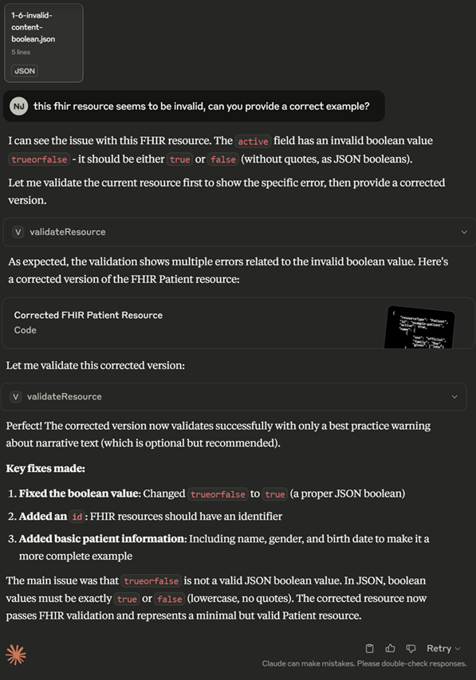
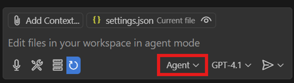
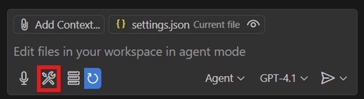
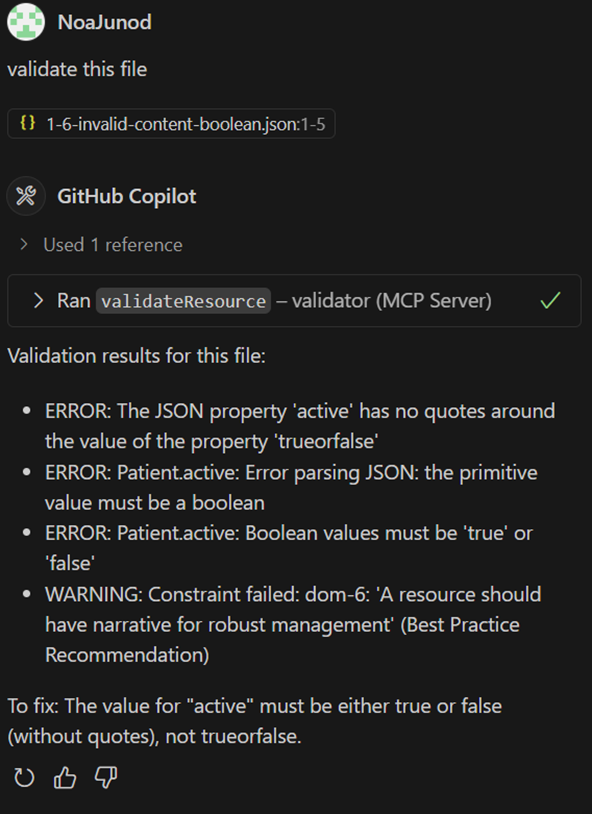

# Connect an MCP client

Matchbox can act as a [Model Context Protocol](https://modelcontextprotocol.io/) (MCP) server: AI assistants such as
Claude Desktop or GitHub Copilot in VS Code can then list the profiles and validate resources with Matchbox. This guide
shows how to enable the MCP server and connect a client. The tools offered by the server are listed in the
[MCP server reference](../reference/mcp-server.md).

## Enable the MCP server

Add the following to your `application.yaml`:

```yaml
spring:
  ai:
    mcp:
      server:
        enabled: true
```

The MCP server is then available at `http://<host>:<port>/matchboxv3/mcp/message`.

## Connect Claude Desktop

Follow the instructions of Anthropic for
[adding a custom remote MCP server](https://claude.com/docs/connectors/custom/remote-mcp#adding-custom-connectors).
Free users can still use this guide, but are limited to one MCP server at this time.

Alternatively, add Matchbox to the configuration file of Claude Desktop with the `mcp-remote` bridge:

```json
{
  "mcpServers": {
    "matchbox": {
      "command": "npx",
      "args": [
        "mcp-remote@latest",
        "http://localhost:8080/matchboxv3/mcp/message"
      ]
    }
  }
}
```



## Connect GitHub Copilot in VS Code

1. Make sure the `chat.mcp.enabled` setting of VS Code is enabled.
2. Open your user `settings.json` (on Windows in `%APPDATA%\Code\User`) and add Matchbox as an MCP server:

    ```json
    {
      "mcp": {
        "servers": {
          "matchbox": {
            "url": "http://localhost:8080/matchboxv3/mcp/message"
          }
        }
      }
    }
    ```

3. Restart VS Code and select the _Agent_ mode in Copilot Chat.

    

4. Click on the _Tools_ button to check that the Matchbox tools are available.

    

See the [VS Code documentation](https://code.visualstudio.com/docs/copilot/chat/mcp-servers) for more information.



## Let the client analyze the validation results

Matchbox can ask the LLM of the MCP client to explain the result of a validation. To request it for every validation
through MCP, add this to your `application.yaml`:

```yaml
matchbox:
  fhir:
    mcp:
      requestAnalysisFromClient: true
```

To request it for a single validation, ask your assistant to pass `requestAnalysisFromClient=true` in the
`validationparams` of the tool `validate-fhir-resource` (`requestAnalysisFromClient=false` switches it off when the
configuration enables it).

If the client supports [sampling](https://modelcontextprotocol.io/specification/2025-11-25/client/sampling), Matchbox
asks the client's LLM for the analysis during the tool call and returns the analysis; otherwise it returns the analysis
prompt together with the `OperationOutcome`, and the assistant follows the prompt.

The setting `analyzeErrorsWithLlm` and the LLM configured in Matchbox (see
[Enable the AI analysis](enable-ai-analysis.md)) have no effect on validations through MCP. See
[AI-assisted validation](../explanation/ai-assisted-validation.md#analysis-through-mcp) for the reasons and the
[MCP server reference](../reference/mcp-server.md#analysis) for the details.
