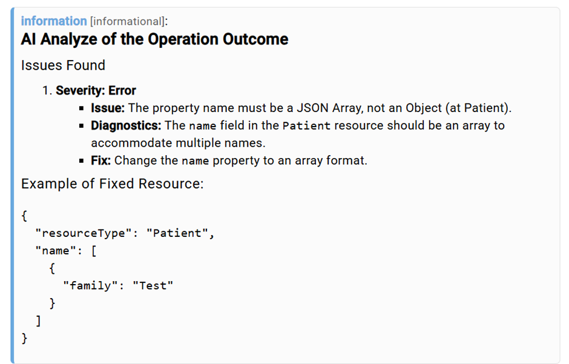

# Enable the AI analysis of validation results

Matchbox can send the result of a failed validation to a large language model (LLM), which explains the errors and
suggests how to fix them. This guide shows how to enable it. Why and how it works is explained in
[AI-assisted validation](../explanation/ai-assisted-validation.md).

## Configure the LLM

Set the provider, the model and your API key in `application.yaml` (the supported providers and models are listed in
the [configuration reference](../reference/configuration.md#llm)):

```yaml
matchbox:
  fhir:
    context:
      llm:
        provider: openai
        modelName: gpt-4o-mini
        apiKey: sk-xxx
```

Don't put the API key in a file under version control: give it as an environment variable instead, e.g.
`MATCHBOX_FHIR_CONTEXT_LLM_APIKEY`.

## Analyze every failed validation

To analyze the result of every validation that has `error` or `fatal` issues, enable `analyzeErrorsWithLlm`:

```yaml
matchbox:
  fhir:
    validation:
      analyzeErrorsWithLlm: true
```

## Analyze a single validation

Leave `analyzeErrorsWithLlm` disabled in the configuration, and add it to the `$validate` request when you want an
analysis:

```http
POST /matchboxv3/fhir/$validate?profile=http://hl7.org/fhir/StructureDefinition/Patient&analyzeErrorsWithLlm=true HTTP/1.1
```

The request parameter also overrides the configuration the other way round (`analyzeErrorsWithLlm=false`).

The LLM can be chosen per request too, with the parameters `llmProvider`, `llmModelName` and `llmApiKey`.

## Read the analysis

In the web interface, the analysis is the first message of the validation result:



In the `OperationOutcome` of `$validate`, it is an additional `information` issue with the text
_AI Analyze of the Operation Outcome_. The `diagnostics` contains the analysis in Markdown, as indicated by the
`rendering-style` extension:

```json
{
  "extension": [
    {
      "url": "http://hl7.org/fhir/StructureDefinition/rendering-style",
      "valueString": "markdown"
    }
  ],
  "severity": "information",
  "code": "informational",
  "details": {
    "text": "AI Analyze of the Operation Outcome"
  },
  "diagnostics": "```markdown\nThe resource has issues labeled as 'error':\n\n1. **Issue**: The property name must be a JSON Array, not an Object (at Patient).\n ..."
}
```

## Related

- [Connect an MCP client](connect-mcp-client.md): let an AI assistant validate resources and analyze the results
  itself.
